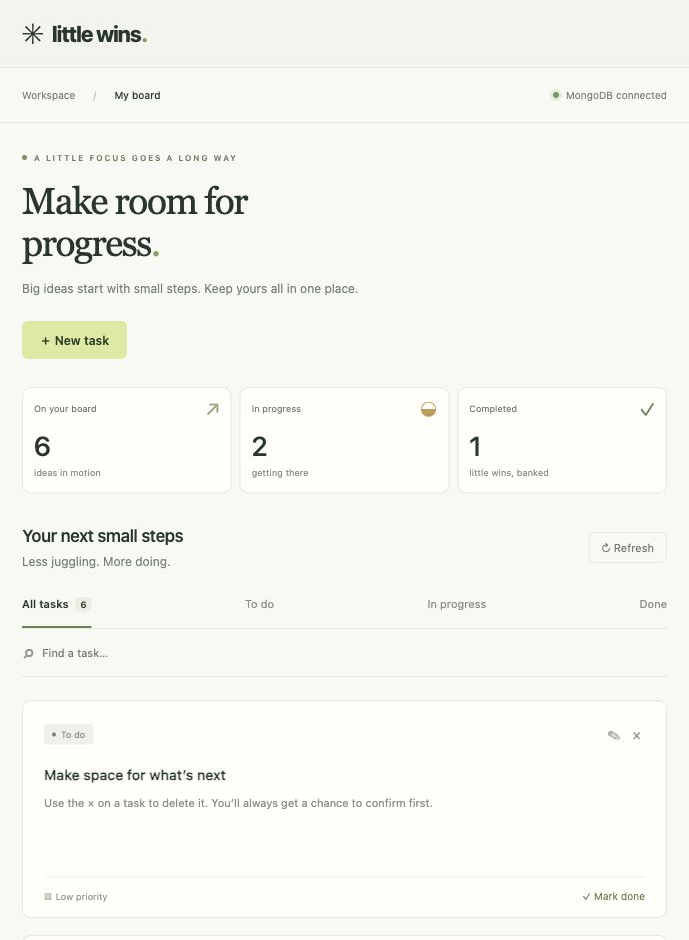

# Little Wins

A small task board that shows how **Python, FastAPI, Beanie, and MongoDB** fit together. Add a task, find it, update its status, or delete it. Every change is saved to MongoDB, and the browser UI uses plain HTML, CSS, and JavaScript.

<details>
<summary>See the task board</summary>



</details>

## Run locally

You'll need **Python 3.11+**, [uv](https://docs.astral.sh/uv/getting-started/installation/), and a running MongoDB instance. Run these commands from the project folder:

```sh
test -f .env || cp .env.example .env
uv sync --locked
uv run --locked python run.py
```

The sample configuration connects to MongoDB at `127.0.0.1:27017`. If you have Docker and need a local instance, start one with:

```sh
docker run --rm --name little-wins-mongo -p 127.0.0.1:27017:27017 mongo:8.0
```

For MongoDB Atlas, set `MONGODB_URI` in your private `.env` to your connection string and set `MONGODB_DATABASE` to a database your user can read and write. If you omit `MONGODB_DATABASE`, the app uses the database in the URI or defaults to `little_wins`. Documents are stored in the `tasks` collection.

Open [localhost:8000](http://127.0.0.1:8000). The launcher opens Chrome on macOS when available and falls back to your default browser. Press **Ctrl+C** to stop the server. The board starts empty; to add sample tasks, run `uv run --locked python scripts/seed.py`.

## Walk through CRUD

| Action | Try it in the browser | FastAPI route | Beanie operation |
| --- | --- | --- | --- |
| Create | Select **New task** and save a title | `POST /api/tasks` | `task.insert()` |
| Read | Browse, search, or filter your tasks | `GET /api/tasks`, `GET /api/tasks/{id}` | `Task.find_all()`, `Task.get(id)` |
| Update | Edit details or select **Mark done** | `PUT /api/tasks/{id}` | `task.set(...)` |
| Delete | Select **×** on a task and confirm | `DELETE /api/tasks/{id}` | `task.delete()` |

The [OpenAPI schema](http://127.0.0.1:8000/openapi.json) describes the request and response bodies. `PUT` replaces the editable task fields; use the title, notes, status, and priority to preserve the existing values.

## Read the code

Start with [the task model](app/models.py), which separates validated API inputs and outputs from the stored Beanie document. Then follow a request through [the FastAPI routes](app/main.py) to MongoDB. The app initializes a single async PyMongo client at startup and closes it at shutdown, following [Beanie's initialization pattern](https://beanie-odm.dev/tutorial/initialization/). The [browser UI](app/static/) calls the JSON API with `fetch`.

## Tests

```sh
uv run --locked pytest -q
```

The default suite checks request boundaries and configuration without connecting to MongoDB. To test persistence, start a local MongoDB instance and run:

```sh
RUN_MONGODB_TESTS=1 \
MONGODB_URI=mongodb://127.0.0.1:27017/little_wins_test \
MONGODB_DATABASE=little_wins_test \
uv run --locked pytest -q
```

The integration suite creates, reads, updates, and deletes its own temporary task. GitHub Actions runs both suites against a disposable MongoDB service without using Atlas credentials.

## Security and scope

Little Wins is a local, single-user example. The launcher binds to loopback, the server checks local hostnames and browser origins, and task content is rendered as text. The app has no login or authorization; sharing the source on GitHub does not mean the running app should be exposed publicly.

Keep real credentials in `.env` or server environment variables. Commit only the placeholder [`.env.example`](.env.example). For reporting and credential guidance, see [SECURITY.md](SECURITY.md).
